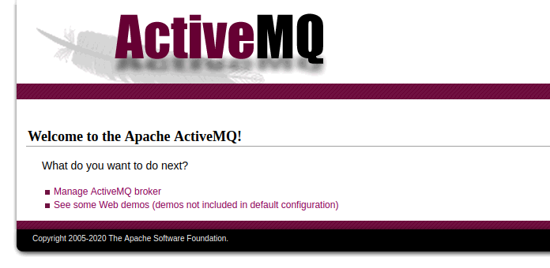

## Reconocimiento de ActiveMQ

Nmap nos devuelve bastantes puertos abiertos. Empiezo por la web, que pide usuario y contraseña nada más cargar. Probamos `admin:admin` y podemos entrar al panel de ActiveMQ.



Revisando el panel encontramos la versión `5.15.15`. Busco información sobre ella y llego a una prueba de concepto en Go que utiliza un XML alojado en nuestro servidor para ejecutar comandos.

## El puerto era la clave

Preparamos `poc-linux.xml` con nuestros datos y lanzamos el script. Al principio lo apunto al puerto `80` y no recibo la shell. Leyendo mejor cómo funciona, veo que la explotación va contra el servicio de mensajería, en el puerto `61616`, que también estaba abierto. Cambiamos el puerto y volvemos a probar. Esta vez sí nos llega la reverse shell.


## Nginx con permisos de root

Dentro de la máquina, `sudo -l` nos muestra que podemos ejecutar `/usr/sbin/nginx` como root. Podemos aprovecharlo para levantar un servidor con una configuración propia y leer archivos a los que nuestro usuario no tiene acceso. Creamos en `/tmp` un archivo de configuración que utiliza `user root`, escucha en el puerto `7777` y sirve `/` con el listado de directorios activado.

```
user root;
worker_processes auto;
pid /run/nginx2.pid;
include /etc/nginx/modules-enabled/*.conf;
events { worker_connections 1024; }
http {
    server {
        listen 7777;
        location / {
            root /;
            autoindex on;
        }
    }
}
```

Lo arrancamos con `sudo /usr/sbin/nginx -c /tmp/pwnd.conf`. Accediendo al nuevo servicio podemos recorrer el sistema de archivos y leer el contenido de `/root`.
