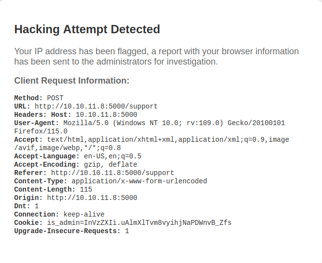
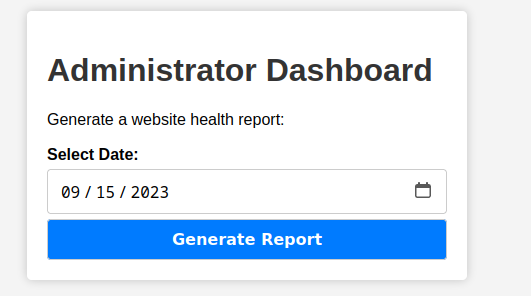
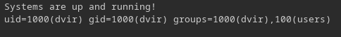

## El formulario de soporte

El escaneo inicial nos muestra SSH y un servicio HTTP en el puerto `5000`. La página tiene una cuenta atrás y un formulario de soporte. Enumerando rutas encontramos también `/dashboard`, pero todavía no podemos acceder al panel. Pruebo una entrada con JavaScript en el formulario y aparece una página de aviso. Lo que me llama la atención es que muestra información de nuestra petición, incluido el `User-Agent`.

## XSS en una cabecera

Interceptamos la petición en Burp Suite y colocamos el payload en `User-Agent`. La idea es que, cuando se revise el aviso, el navegador envíe la cookie a nuestro servidor HTTP. Recibimos la petición con la cookie. La ponemos en nuestra sesión y volvemos a `/dashboard`: esta vez podemos entrar.

## Inyección al generar informes

El panel permite generar un informe a partir de una fecha. Mandamos esa petición a Burp y probamos si el valor acaba formando parte de un comando. Introduciendo `id` conseguimos ver su salida.

Tenemos ejecución de comandos. Después de probar varias formas de recibir una reverse shell, la que me funciona aquí es con Netcat.

## Escalada de privilegios

Una vez dentro, tratamos la terminal y revisamos los permisos de sudo. Podemos ejecutar un script Bash como root. Al leerlo vemos que llama a otro script que podemos modificar. Lo preparamos para que nos mande una reverse shell y ejecutamos la tarea privilegiada. Recibimos la conexión como root.
