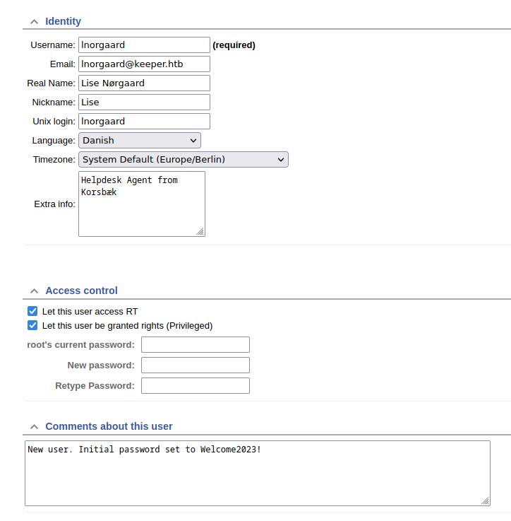
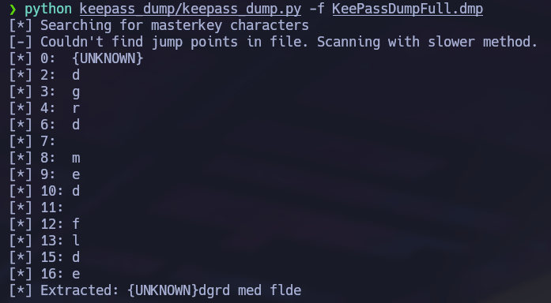

## De Request Tracker a SSH

Empezamos con Nmap y vemos los puertos `22` y `80`. La web muestra un login de Request Tracker. Busco las credenciales por defecto y consigo entrar. Dentro reviso la administración de usuarios. En uno de los perfiles encuentro una contraseña escrita en los comentarios. La pruebo por SSH con ese usuario y funciona.




## Un volcado de KeePass

En el sistema encontramos un ZIP con dos archivos interesantes: una base de datos `.kdbx` y un volcado de memoria `.dmp` de KeePass. Utilizo `keepass_dump` para recuperar pistas sobre la contraseña maestra. La salida no es completa: faltan caracteres y algunos símbolos no se representan bien.



Buscando la expresión que se alcanza a leer encuentro una referencia que ayuda a reconstruir la contraseña. La pruebo con `kpcli` y puedo abrir la base de datos.


## La clave de root

Dentro de KeePass recorremos las entradas hasta encontrar la información de acceso del servidor. En las notas hay una clave privada en formato PuTTY. La exportamos y la convertimos a formato OpenSSH con `puttygen`. Después restringimos sus permisos con `chmod 600` y la usamos para conectarnos:

```bash
ssh root@10.10.11.227 -i id_rsa
```

El acceso funciona y entramos directamente como root.
