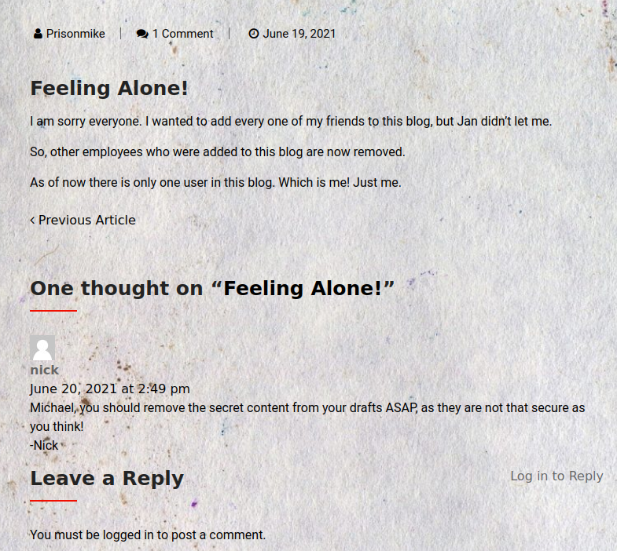
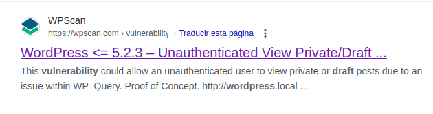
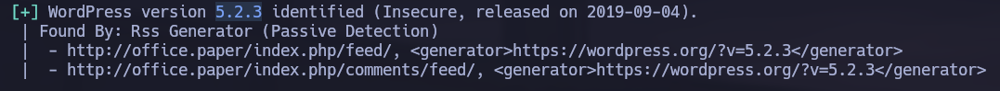
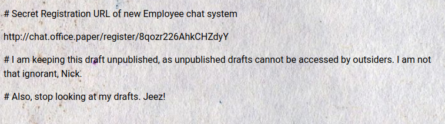
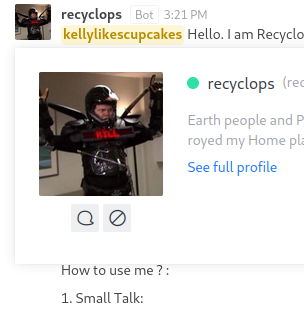
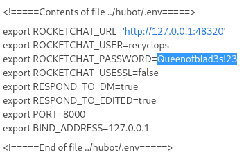
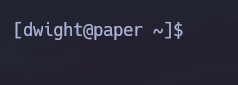

## La pista estaba en las cabeceras

Empezamos enumerando los servicios y revisando la web. Solo aparece una página por defecto de Apache, pero al consultar las cabeceras del puerto `80` encontramos una referencia a `office.paper`. Añadimos el dominio a `/etc/hosts` y llegamos a un blog de WordPress. Uno de los comentarios menciona borradores, así que revisamos la versión con WPScan y buscamos información sobre la exposición de ese contenido.

La prueba nos permite leer borradores que no deberían ser públicos. En ellos aparece un enlace de invitación a un chat interno. Añadimos el nuevo dominio a `/etc/hosts` y nos registramos.

## Hablando con Recyclops

En el chat encontramos un bot llamado `Recyclops` que puede listar archivos. En la conversación general solo tenemos lectura, pero podemos abrirle un mensaje privado y probar ahí sus funciones.

Le pedimos que liste su directorio de trabajo y después probamos a salir de la ruta esperada. Además de listar, puede mostrar el contenido de archivos con su función `file`.

## Credenciales en el entorno del bot

Revisando el proyecto de Hubot encontramos `.env`. Pedimos al bot que lo lea y aparecen credenciales. Las probamos por SSH y podemos entrar en el sistema.

## Escalada con Polkit

Después de revisar el sistema sin encontrar una vía clara, utilizo LinPEAS. Entre sus resultados aparece una versión de Polkit que investigamos para la escalada. El script que utilizamos crea un usuario con permisos de sudo. Cambiamos a ese usuario y, desde ahí, elevamos la sesión a root.
