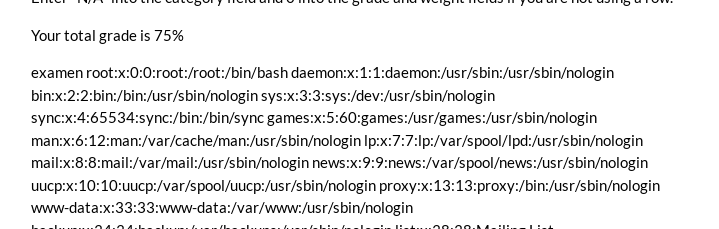
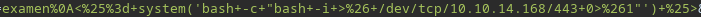
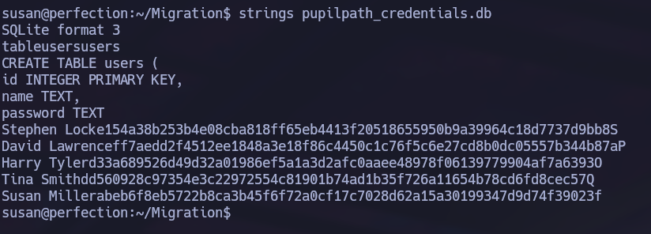

## Una calculadora hecha en Ruby

Nmap muestra los puertos `22` y `80`. Revisando la web encontramos información sobre el framework y vemos que la aplicación está hecha en Ruby.

La parte que más me interesa es una calculadora de notas con varios campos de entrada. Llevo la petición a Burp Suite y pruebo una inyección de plantilla.

## Saltando la validación

El primer intento se bloquea. Seguimos probando hasta encontrar una forma de introducir un salto de línea que permite superar la comprobación. Esta vez la aplicación evalúa la multiplicación que enviamos.

Con la ejecución de Ruby confirmada, probamos a leer `/etc/passwd`. La salida aparece en la respuesta, así que ya tenemos una vía para ejecutar código.

## Reverse shell

Preparamos un payload con una función de Ruby para ejecutar el comando de conexión y nos ponemos en escucha en el puerto `443`.

Recibimos la shell y tratamos la terminal. A partir de aquí seguimos revisando los archivos del sistema para encontrar información que nos permita avanzar.

## Acceso a root

Durante esa revisión encontramos información útil para obtener la contraseña de `susan`.

Comprobamos sus permisos y vemos que pertenece al grupo `sudo`. Con la contraseña podemos elevar la sesión y entrar como root.
