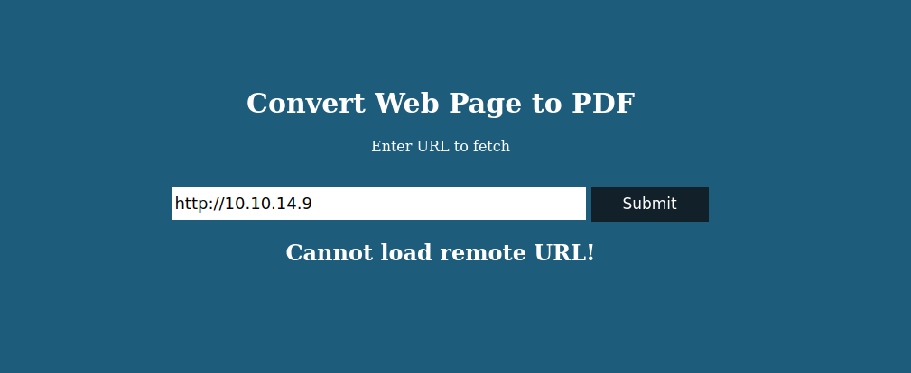
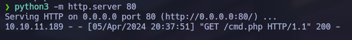
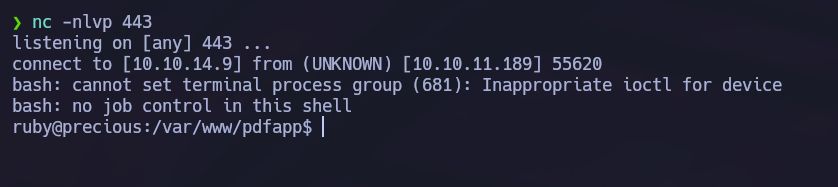
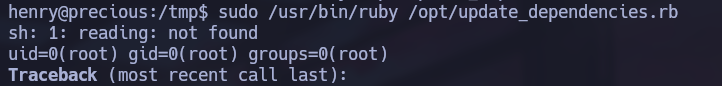

## Un generador de PDF

El escaneo nos muestra los puertos `22` y `80`. La web permite introducir una URL y convertir su contenido en PDF. Levantamos un servidor HTTP en nuestro equipo para que la aplicación visite una página que controlamos.



Descargamos el PDF y lo revisamos con ExifTool. En sus metadatos aparece PDFKit y podemos identificar la versión que está utilizando la aplicación.


## Inyección de comandos en PDFKit

Buscamos información sobre esa versión y encontramos una inyección de comandos. Antes de intentar una shell hacemos una prueba sencilla para comprobar si realmente se ejecuta el comando.




La prueba funciona. Preparamos una reverse shell codificada en Base64 para evitar problemas al pasarla como parte de la URL. La enviamos y recibimos la conexión.



## Cambiando al usuario henry

Revisando los archivos del entorno encontramos una configuración de Bundler en `.bundle` con credenciales. Las probamos para cambiar a `henry` y funcionan. Con `sudo -l` vemos que puede ejecutar `/opt/update_dependencies.rb` con Ruby como root. Leemos el script y encontramos que carga un archivo YAML utilizando una ruta relativa.

## Deserialización de YAML

El detalle importante es cómo se carga ese YAML: podemos colocar un archivo preparado por nosotros en el directorio de trabajo y hacer que Ruby procese su contenido al ejecutar el script permitido por sudo. Preparamos una prueba de deserialización y ejecutamos:

```bash
sudo /usr/bin/ruby /opt/update_dependencies.rb
```



La salida muestra `uid=0(root)`. Después aparece un error de Ruby, pero el comando ya se ha ejecutado con privilegios de root. Con esto confirmamos la escalada mediante el script.
