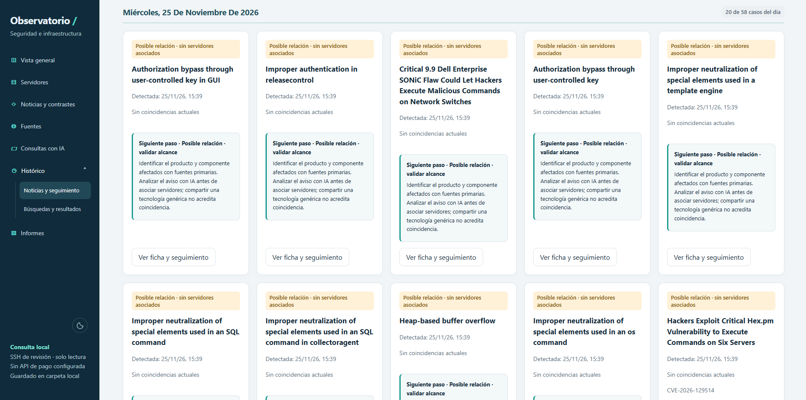

<p class="intro">Lo he programado con Codex, el agente de programación de OpenAI. El repositorio es privado, así que aquí explico cómo funciona y enseño algunas capturas. Son de una instalación que está en uso y en ellas solo salen avisos públicos.</p>

## El problema

Cuando sale un aviso de seguridad hay que mirar si el producto que menciona está instalado, en qué versión, y qué versiones da el fabricante como corregidas. Con decenas de avisos al día, hacerlo a mano lleva mucho tiempo y es fácil equivocarse: das un servidor por afectado porque usa la misma tecnología que sale en la noticia, o lo das por corregido sin haberlo comprobado.

## Cómo funciona

```
Fuentes públicas → recogida y deduplicación → contraste ← inventario local
                                                  ↓
Navegador ⇄ servidor Node.js local ⇄ estado en JSON
                     ↓
          consultas opcionales a Codex
```

Cada cierto tiempo consulta las fuentes que tengo configuradas: blogs de fabricantes, blogs de investigación e índices públicos. En cada pasada revisa hasta 20, con dos descargas a la vez, y descarta los avisos repetidos por URL.

Después compara cada aviso con el inventario por fabricante, distribución, paquete y versión. Cada caso se queda guardado con el día en que se detectó, las revisiones que se le han hecho y el siguiente paso.

Desde la propia aplicación también se le pueden hacer consultas a Codex. Se preparan con sus referencias, las envío yo y la respuesta vuelve a la aplicación con las fuentes que ha usado. Es opcional y sin configurarlo no se envía nada.

## Cómo clasifica los avisos

Cada aviso acaba en uno de estos tres grupos:

- **Coincidencia comprobada:** el alcance del aviso y el componente concreto que tengo instalado respaldan la relación.
- **Posible relación:** falta identificar el producto, el componente o un criterio con el que comparar. Que el aviso hable de una tecnología que uso no basta para asignarle servidores.
- **Informativa:** el artículo es documentación o contexto y no trae una vulnerabilidad que se pueda comprobar por versiones.

Cada ficha dice también hasta dónde llega la comprobación. Si la versión instalada ya incluye la corrección, el paquete está al día, pero eso no demuestra que los procesos que están corriendo hayan cargado el parche, ni cómo está configurado el servicio, ni si está expuesto.

## Las vistas





## La seguridad de la propia herramienta

Como guarda un inventario de servidores, la herramienta también tenía que estar bien protegida:

- El servidor solo escucha en `127.0.0.1` y comprueba las cabeceras `Host` y `Origin` de cada petición.
- Para escribir hace falta una cabecera propia, y la interfaz tiene una política CSP.
- Antes de descargar una fuente se descartan las IP privadas y la IP resuelta se queda fijada, así no se le puede colar un DNS rebinding.
- El estado se guarda de forma atómica y con control de revisión. El HTML se escapa y las URL se validan antes de mostrarlas.
- La versión que tengo en el repositorio lleva SSH desactivado. Las consultas por SSH solo se conservan para pruebas simuladas.

## Pruebas

Tiene tres comprobaciones automáticas que cubren la clasificación por fabricante y componente, la retención del histórico, las actualizaciones parciales y los casos con varios datos por servidor. Usan inventarios inventados y respuestas SSH simuladas.

## Lo que me queda por mejorar

Después de la primera versión revisé el código y el diseño con Claude, y salieron varias cosas pendientes:

- El motor y la vista de servidores leen el inventario de sitios distintos. Tiene que haber uno solo.
- En el móvil, a 400 px de ancho, la interfaz se sale de la pantalla.
- Algunos archivos del frontend son demasiado grandes y solo hay pruebas del backend.
- En cada petición vuelve a leer el estado entero, que puede llegar a 12 MB.
